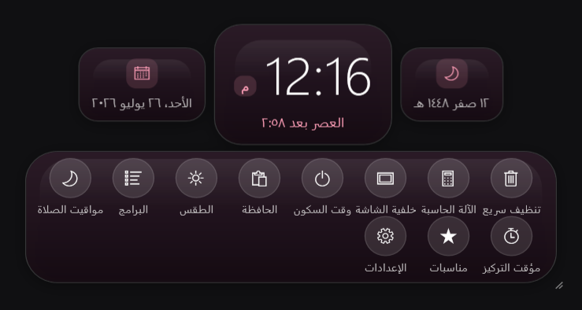

# DeskMate — ديسك ميت

أداة سطح مكتب لويندوز: ساعة وتاريخ في منتصف الشاشة مع أدوات سريعة أسفلها — تظهر كجزء من سطح المكتب (خلف كل النوافذ دائماً)، بالعربية والإنجليزية.

A Windows desktop widget: a beautiful clock & date with quick tools beneath it — lives on the desktop layer (always below your apps), in Arabic and English.



## الملفات النهائية · Final files

| File | What it is |
|---|---|
| `dist/DeskMate.exe` | **نسخة محمولة** — شغّلها من أي مكان، بلا تثبيت (~200 KB) · Portable — run from anywhere, no install |
| `dist/DeskMateSetup.exe` | **المُثبّت** — تثبيت دائم بأيقونة سطح مكتب وقائمة ابدأ وتشغيل تلقائي · Installer — permanent install with desktop icon, Start Menu and autostart |

لا يحتاج أي متطلبات — يعمل على ويندوز 10/11 مباشرة (.NET Framework 4.8 مدمج في النظام).
No prerequisites — runs on Windows 10/11 as-is (.NET Framework 4.8 is built into Windows).

## الأدوات · Tools

| | الأداة | Tool |
|---|---|---|
| 🕐 | ساعة وتاريخ (رقمية / عقارب / بسيطة) + التاريخ الهجري | Clock & date (digital / analog / minimal) + Hijri date |
| 🗑 | تنظيف سريع لمخلفات ويندوز مع خيار إفراغ سلة المحذوفات | Quick clean of Windows leftovers + optional Recycle Bin |
| 🧮 | آلة حاسبة بسيطة تتحول لعلمية بزر واحد | Calculator, one click switches to scientific |
| 🖼 | تغيير خلفية سطح المكتب مع طريقة العرض | Wallpaper changer with fit style |
| ⏻ | ضبط وقت دخول السكون (شاحن / بطارية) | Sleep timeout presets (AC / battery) |
| 📋 | حافظة نصوص مؤقتة مع تثبيت وحذف | Clipboard text keeper with pin/delete |
| ☀ | الطقس الحالي + 3 أيام (تحديد موقع تلقائي أو مدينة يدوية) | Current weather + 3-day forecast (auto or manual location) |
| 📂 | قائمة برامج ويندوز (تشمل تطبيقات المتجر): فتح أو **إضافة لسطح المكتب** بنقرة | Installed apps incl. Store apps: open or **add to desktop** in one click |
| 🌙 | مواقيت الصلاة (حساب فلكي محلي، 5 طرق حساب) مع تنبيه عند الوقت وتنبيه مسبق وصوت تنبيه قابل للاختيار (نظام / ناعم / ملف مخصص) | Prayer times (offline astronomical calc, 5 methods) with at-time & pre-alerts and a choice of alert sound (system / soft chime / custom file) |
| ⏱ | مؤقت تركيز (بومودورو) بحلقة تقدم وجلسات يومية واستراحة تلقائية | Focus timer (pomodoro) with progress ring, daily session count and auto break |
| ★ | عدّ تنازلي للمناسبات الهجرية (رمضان والعيدان) + تاريخ مخصص | Hijri occasions countdown (Ramadan, both Eids) + a custom date |
| ✎ | ملاحظة لاصقة تُحفظ تلقائياً أثناء الكتابة | Sticky note, auto-saved as you type |
| ⊞ | مراقب موارد: معالج وذاكرة وبطارية بأشرطة حية | System monitor: live CPU / memory / battery bars |
| ◎ | ساعات عالمية لمدن تختارها مع فرق اليوم | World clocks for your cities, with day-offset badges |
| ⚙ | إعدادات: اللغة، شكل الساعة، إظهار/إخفاء كل أداة، التشغيل مع ويندوز | Settings: language, clock style, show/hide any tool, autostart |
| 🎨 | 12 ثيماً + ثيم تلقائي اختياري (فاتح نهاراً والمختار ليلاً) + ثيم من خلفية الشاشة + شفافية قابلة للضبط + تكبير/تصغير بمقبض الزاوية | 12 themes + optional auto theme (light by day) + wallpaper theme + adjustable transparency + corner-grip resizing |
| 🧊 | 8 أشكال للأداة — منها «مجسم» بعمق ثلاثي الأبعاد و«هالة» بحلقة دوّارة | 8 widget shapes — incl. the 3D «Monolith» slab and the revolving-ring «Halo» |
| ✦ | سطر موسمي تحت الساعة: اقتراب المناسبات، وعدّاد إفطار حي في رمضان، وتهانئ العيد — يظهر ويختفي مع حجم الأداة تلقائياً | Seasonal line under the clock: occasion countdowns, live Ramadan iftar timer, Eid greetings — appears/hides with widget size automatically |
| 📌 | اللوحات مثبّتة افتراضياً: تبقى مفتوحة أثناء عملك ولا تُغلق إلا أنت — أو أعد السلوك القديم من الإعدادات | Panels are pinned by default: they stay open while you work and only you close them — or restore the old behaviour in Settings |

كل أيقونة يظهر اسم أداتها تحتها دائماً — لا حاجة للتخمين. · Every icon shows its tool's name beneath it — no guessing.

## سلوك الأداة · Behavior

- تبقى دائماً **خلف** النوافذ المفتوحة — لا تزاحم عملك.
- اسحبها لأي مكان؛ موضعها يُحفظ.
- أيقونة في منطقة الإشعارات (Tray): إظهار/إخفاء، الإعدادات، إغلاق.
- تشغيل نسخة ثانية يُظهر الأداة فقط (نسخة واحدة دائماً).
- الإعدادات في `%AppData%\DeskMate\settings.json`.

## البناء من المصدر · Build from source

```powershell
powershell -ExecutionPolicy Bypass -File build.ps1
```

يتطلب VS 2022 Build Tools (مترجم Roslyn) فقط — بدون ‎.NET SDK وبدون NuGet. يقوم السكربت بتوليد الأيقونة، تشغيل 284 اختباراً ذاتياً للمنطق، بناء `DeskMate.exe` ثم `DeskMateSetup.exe`.

Requires only VS 2022 Build Tools (Roslyn csc) — no .NET SDK, no NuGet. The script generates the icon, runs 284 logic self-tests, builds `DeskMate.exe` then `DeskMateSetup.exe`.

```powershell
# لقطات معاينة لكل التخطيطات واللوحات في obj\uishots · render every layout & panel to obj\uishots
powershell -ExecutionPolicy Bypass -File build.ps1 -UiSmoke
```

### خيارات المُثبّت · Installer switches

- `DeskMateSetup.exe --silent` — تثبيت صامت بالخيارات الافتراضية · silent install
- `Uninstall.exe --uninstall` — إزالة (تُنشأ داخل مجلد التثبيت) · uninstall
